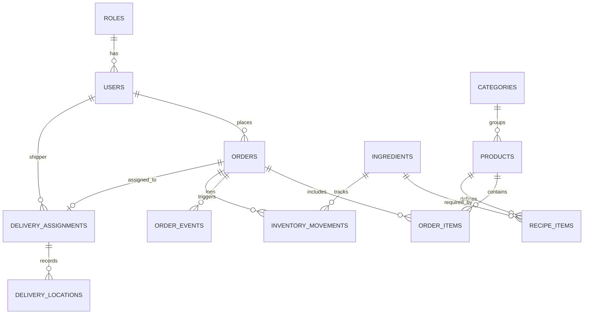

# KIẾN TRÚC HỆ THỐNG VÀ KẾ HOẠCH DỰ ÁN BÁNH MÌ 0
*Hệ thống Thương mại Điện tử và Quản lý Vận hành F&B Đa Nền tảng*  
**Thương hiệu:** BÁNH MÌ 0  
**Slogan:** TRÒN VỊ MỖI NGÀY – NÓNG GIÒN TỪNG Ổ  
**Design Signature:** DESIGN BY TRISTAN.TEAMA4  
**Tài liệu:** Giai đoạn 1 – Phân tích Kiến trúc & Lập Kế hoạch Kỹ thuật

---

## 1. TỔNG QUAN HỆ THỐNG & MỤC TIÊU DỰ ÁN

Dự án **BÁNH MÌ 0** là một hệ thống web full-stack tích hợp kép (Dual-Engine Platform):
1. **Customer Front Store (Cửa hàng trực tuyến cho khách):** Trải nghiệm thương hiệu ẩm thực đường phố cao cấp (Premium Vietnamese Street Food), đặt bánh mì mang đi hoặc giao tận nơi, tùy biến số lượng/ghi chú, theo dõi tiến trình đơn hàng theo thời gian thực.
2. **Operations & Admin Hub (Trung tâm quản trị & vận hành):** Quản lý thực đơn sản phẩm, danh mục, kho nguyên vật liệu theo định lượng công thức (BOM - Bill of Materials), tự động trừ kho an toàn chống trùng lặp, phân quyền nhân sự (Admin, Staff, Shipper) và điều phối giao hàng kèm định vị thực tế.

---

## 2. KẾT QUẢ KHẢO SÁT MÔI TRƯỜNG & WORKSPACE

- **Hệ điều hành:** Windows 10/11 x64
- **Node.js Runtime:** `v24.19.0` (LTS/Current, hỗ trợ đầy đủ ES Modules, Fetch API gốc, SQLite tích hợp)
- **Package Manager:** `npm 11.17.0`
- **Version Control:** `git version 2.55.0.windows.5`
- **Thư mục dự án:** `c:\Users\Admin\Downloads\PAGE-BANH-MI`
- **Tài sản thương hiệu ban đầu:** Đã lưu trữ mockup nhận diện thương hiệu tại `uploads/brand/brand_mockup.jpg` gồm logo tròn BÁNH MÌ 0, bao bì giấy kraft, hộp takeaway, nhận diện ứng dụng di động/tablet.

---

## 3. LỰA CHỌN CÔNG NGHỆ VÀ LÝ DO KỸ THUẬT

### 3.1. Frontend
- **Framework:** `React 18 / 19` với **Vite** và **TypeScript**:
  - Tối ưu hiệu năng bundling, Hot Module Replacement (HMR) tức thì dưới 100ms.
  - TypeScript nghiêm ngặt đảm bảo type-safety cho dữ liệu giỏ hàng, thông tin đơn hàng và giao diện phân quyền.
- **Styling:** **Tailwind CSS v3**:
  - Thiết lập Design System với bảng màu thương hiệu đặc trưng:
    - Vàng kem bánh mì: `#FBF7EE` / `bg-warm-cream`
    - Nâu bánh mì nướng: `#5C3A21` / `text-crust-brown`
    - Đỏ ớt & sốt thương hiệu: `#C83214` / `bg-brand-red`
    - Xanh rau thơm tươi: `#2D6A4F` / `text-fresh-green`
    - Trắng ngà thanh lịch: `#F4EFEA`
- **Typography:** Font `Be Vietnam Pro` (Google Fonts), hiển thị dấu tiếng Việt chuẩn xác 100%, không lỗi chân chữ.
- **Motion & Interaction:** **Framer Motion**:
  - Tạo hiệu ứng Intro thương hiệu mượt mà, chuyển cảnh trang nhẹ nhàng, micro-interactions khi bấm thêm giỏ hàng.
- **Icons:** **Lucide React** (bộ icon tối giản, hiện đại, kích thước nhẹ).

### 3.2. Backend
- **Runtime & Framework:** **Node.js** + **Express.js** với **TypeScript**:
  - Xây dựng chuẩn mực RESTful API rõ ràng, phân tầng Controller - Service - Repository.
- **Bảo mật & Auth:**
  - `bcryptjs`: Hash mật khẩu với salt rounds = 10.
  - `jsonwebtoken` (JWT): Xác thực phiên làm việc stateless qua header `Authorization: Bearer <token>`.
  - Phân quyền theo vai trò (Role-Based Access Control - RBAC): `CUSTOMER`, `SHIPPER`, `STAFF`, `ADMIN`.
- **Validation:** `zod` hoặc middleware kiểm tra dữ liệu đầu vào nghiêm ngặt (Validate schema request body & query).
- **CORS & Bảo vệ headers:** `cors`, `helmet`, `express-rate-limit` chống spam brute-force login.

### 3.3. Database & Dữ liệu
- **Giai đoạn Phát triển (Development):** **SQLite** (thư viện `better-sqlite3` hoặc `sqlite3`) lưu trữ dạng file độc lập `database/banhmi0.sqlite`, không cần cài đặt dịch vụ database cồng kềnh, sao lưu và di chuyển cực kỳ dễ dàng.
- **Giai đoạn Vận hành thực tế (Production):** Sẵn sàng cấu hình chuyển đổi sang **PostgreSQL** qua lớp Database Access Layer trừu tượng hóa, hoàn toàn tương thích cấu trúc bảng và câu lệnh SQL chuẩn.

---

## 4. CẤU TRÚC THƯ MỤC DỰ ÁN

```
BANH_MI_0/
├── docs/                             # Tài liệu kỹ thuật, báo cáo cuộc thi
│   ├── ARCHITECTURE.md               # Kiến trúc & kế hoạch (file này)
│   ├── DATABASE.md                   # Thiết kế CSDL & Data Dictionary
│   ├── API.md                        # Đặc tả RESTful API
│   ├── USER_GUIDE.md                 # Hướng dẫn khách hàng
│   ├── ADMIN_GUIDE.md                # Hướng dẫn quản trị viên & Shipper
│   └── TEST_REPORT.md                # Báo cáo kiểm thử tự động & thủ công
├── database/                         # Migrations và dữ liệu mẫu
│   ├── migrations/                   # DDL scripts tạo bảng tuần tự
│   │   ├── 001_init_schema.sql
│   │   └── 002_seed_initial_data.sql
│   └── banhmi0.sqlite                # File CSDL cục bộ (git ignored)
├── backend/                          # Mã nguồn máy chủ Node.js/Express
│   ├── src/
│   │   ├── config/                   # Biến môi trường, kết nối DB
│   │   ├── controllers/              # Bộ điều khiển tiếp nhận request
│   │   │   ├── auth.controller.ts
│   │   │   ├── product.controller.ts
│   │   │   ├── category.controller.ts
│   │   │   ├── order.controller.ts
│   │   │   ├── inventory.controller.ts
│   │   │   ├── delivery.controller.ts
│   │   │   └── stats.controller.ts
│   │   ├── middlewares/              # Xác thực JWT, RBAC, Validate, RateLimit
│   │   │   ├── auth.middleware.ts
│   │   │   ├── role.middleware.ts
│   │   │   ├── validate.middleware.ts
│   │   │   └── error.middleware.ts
│   │   ├── models/                   # Kiểu dữ liệu & DB queries
│   │   ├── routes/                   # Định tuyến API (/api/v1/...)
│   │   ├── services/                 # Nghiệp vụ: tính giá, trừ kho an toàn
│   │   └── utils/                    # Hash, JWT token, format response
│   ├── package.json
│   └── tsconfig.json
├── frontend/                         # Ứng dụng React + Vite + Tailwind
│   ├── public/                       # Favicon, assets tĩnh
│   ├── src/
│   │   ├── assets/                   # Ảnh logo, minh họa
│   │   ├── components/               # UI components dùng chung
│   │   │   ├── layout/               # Header, Footer, Navbar, AdminSidebar
│   │   │   ├── common/               # Button, Modal, Badge, Toast, Spinner
│   │   │   ├── customer/             # ProductCard, CartDrawer, OrderStepper
│   │   │   └── admin/                # MetricCard, Table, StatusDropdown
│   │   ├── context/                  # AuthContext, CartContext, ToastContext
│   │   ├── pages/                    # Các trang hiển thị
│   │   │   ├── IntroSplash.tsx       # Intro mở đầu thương hiệu
│   │   │   ├── HomePage.tsx          # Trang chủ chính
│   │   │   ├── MenuPage.tsx          # Thực đơn & lọc món
│   │   │   ├── ProductDetailPage.tsx # Chi tiết món bánh mì
│   │   │   ├── CheckoutPage.tsx      # Đặt hàng & ghi chú
│   │   │   ├── OrderTrackingPage.tsx # Theo dõi đơn & trạng thái
│   │   │   ├── LoginPage.tsx         # Đăng nhập
│   │   │   ├── RegisterPage.tsx      # Đăng ký
│   │   │   ├── ProfilePage.tsx       # Thông tin & lịch sử đơn
│   │   │   ├── admin/                # Các trang Quản trị
│   │   │   │   ├── DashboardPage.tsx
│   │   │   │   ├── ProductsPage.tsx
│   │   │   │   ├── CategoriesPage.tsx
│   │   │   │   ├── OrdersPage.tsx
│   │   │   │   ├── InventoryPage.tsx
│   │   │   │   └── SettingsPage.tsx
│   │   │   └── shipper/              # Giao diện dành riêng cho Shipper
│   │   │       └── ShipperTasksPage.tsx
│   │   ├── services/                 # Gọi API backend (Axios / Fetch)
│   │   ├── types/                    # TypeScript interfaces
│   │   ├── App.tsx                   # Routing (React Router v6)
│   │   ├── main.tsx
│   │   └── index.css                 # Tailwind directives & theme font
│   ├── package.json
│   ├── tailwind.config.js
│   ├── vite.config.ts
│   └── tsconfig.json
├── uploads/                          # Thư mục lưu ảnh upload
│   ├── brand/                        # Nhận diện thương hiệu
│   └── products/                     # Ảnh sản phẩm do Admin tải lên
├── .env.example                      # Mẫu biến môi trường an toàn
├── .gitignore                        # Loại trừ node_modules, secrets, DB file
└── README.md                         # Hướng dẫn tổng quan
```

---

## 5. THIẾT KẾ CƠ SỞ DỮ LIỆU (DATABASE SCHEMA)

Hệ thống quản lý 13 bảng dữ liệu cốt lõi, đảm bảo toàn vẹn dữ liệu qua Foreign Keys và Transaction an toàn:



### Các bảng chi tiết:
1. `roles`: Quản lý 4 vai trò (`CUSTOMER`, `SHIPPER`, `STAFF`, `ADMIN`).
2. `users`: Tài khoản, mật khẩu đã hash bcrypt, họ tên, số điện thoại, địa chỉ, role_id.
3. `categories`: Danh mục món ăn (Bánh mì truyền thống, Bánh mì chả/thịt, Combo nước).
4. `products`: Sản phẩm (mã SKU, tên, giá bán, ảnh, mô tả, thành phần, tồn kho, trạng thái hiển thị).
5. `ingredients`: Danh sách nguyên vật liệu kho (vỏ bánh mì, thịt nguội, chả lụa, pate, trứng gà, dưa leo, rau ngò, sốt bơ trứng, bao bì giấy kraft...).
6. `recipe_items`: Định lượng nguyên vật liệu cho từng món (BOM - Bill of Materials).
7. `orders`: Đơn hàng (mã đơn `BM0-XXXXXX`, user_id, tên người nhận, sđt, địa chỉ nhận, phương thức lấy hàng [Giao tận nơi / Lấy tại tiệm], tổng tiền, trạng thái đơn, cờ đã trừ kho `is_inventory_deducted`).
8. `order_items`: Chi tiết từng món trong đơn, **lưu snapshot giá và tên sản phẩm** tại thời điểm đặt để ngăn sai lệch giá khi menu thay đổi.
9. `order_events`: Lịch sử vết thời gian đổi trạng thái đơn (audit trail).
10. `inventory_movements`: Lịch sử xuất/nhập/điều chỉnh kho có ghi rõ lý do hoặc liên kết với order_id.
11. `delivery_assignments`: Điều phối đơn cho Shipper cụ thể.
12. `delivery_locations`: Tọa độ GPS thực tế của Shipper (chỉ ghi nhận khi Shipper chủ động bật chia sẻ định vị).
13. `settings`: Cài đặt cấu hình cửa hàng (giờ mở cửa, phí ship, ngưỡng cảnh báo kho).

---

## 6. NGUYÊN TẮC NGHIỆP VỤ & BẢO MẬT BẮT BUỘC

1. **Backend tính toán lại 100% giá tiền:** 
   Frontend gửi danh sách `[{ product_id, quantity }]`. Backend truy vấn giá gốc hiện hành từ CSDL, nhân số lượng và cộng phí ship/giảm giá nếu có. Tuyệt đối không chấp nhận tổng tiền gửi lên từ client.
2. **Cơ chế trừ kho một lần duy nhất (Single Inventory Deduction):**
   Mỗi đơn hàng có cờ `is_inventory_deducted` (BOOLEAN DEFAULT 0). Khi đơn chuyển sang trạng thái chỉ định (`CONFIRMED` hoặc `PREPARING`), hệ thống kiểm tra cờ này trong một Database Transaction. Nếu đã trừ thì bỏ qua, nếu chưa thì trừ kho và bật cờ = 1.
3. **Quyền riêng tư vị trí Shipper (Real GPS with Consent):**
   Shipper giao diện có nút bật/tắt định vị rõ ràng. Chỉ gửi tọa độ khi được cấp quyền qua trình duyệt (`navigator.geolocation`). Nếu không có dữ liệu, hệ thống hiển thị thông báo trung thực: *"Chưa có dữ liệu vị trí giao hàng trực tiếp"*.
4. **Bảo vệ mật khẩu và tài khoản Admin:**
   Không ghi mật khẩu trong frontend. Tài khoản Admin khởi tạo an toàn qua script bootstrap hoặc biến môi trường `ADMIN_BOOTSTRAP_*`.

---

## 7. RỦI RO KỸ THUẬT & PHƯƠNG ÁN XỬ LÝ

| Rủi ro | Mức độ | Phương án xử lý |
| :--- | :---: | :--- |
| Trừ trùng kho khi mạng chập chờn hoặc click đúp | Cao | Áp dụng DB Transaction và kiểm tra cờ `is_inventory_deducted` nguyên tử. |
| Dữ liệu hình ảnh tải lên làm quá tải ổ đĩa | Vừa | Giới hạn dung lượng upload (tối đa 2MB), chỉ cho phép định dạng ảnh (jpg, png, webp). |
| Sai lệch tọa độ GPS hoặc Shipper không có GPS | Thấp | Không giả lập tọa độ ảo; hiển thị trạng thái chuẩn xác "Chưa có dữ liệu vị trí". |
| Lỗi bảng mã tiếng Việt trên các thiết bị | Thấp | Nhúng font Google Fonts `Be Vietnam Pro` chuẩn với unicode range tiếng Việt. |

---

## 8. DỊCH VỤ BÊN NGOÀI CẦN THIẾT

1. **Google Fonts API:** Nhúng font `Be Vietnam Pro` (hoàn toàn miễn phí, CDN tốc độ cao).
2. **OpenStreetMap / Leaflet (Tùy chọn hiển thị bản đồ):** Sử dụng OpenStreetMap miễn phí nếu cần hiển thị vị trí Shipper trực quan mà không phát sinh phí API Google Maps.
3. **Lưu trữ ảnh Cloud (Production):** Cloudinary hoặc AWS S3/Cloud Storage (Giai đoạn local lưu trực tiếp thư mục `uploads/`).

---

## 9. DANH MỤC THƯ VIỆN DỰ KIẾN CÀI ĐẶT

### Frontend (`frontend/package.json`):
- `react`, `react-dom`, `react-router-dom`
- `lucide-react` (Bộ icon ẩm thực, giỏ hàng, bảng điều khiển)
- `framer-motion` (Chuyển động Intro và hoạt họa tương tác)
- `clsx`, `tailwind-merge` (Xử lý class CSS linh hoạt)
- `canvas-confetti` (Hiệu ứng mừng hoàn tất đặt hàng thành công)

### Backend (`backend/package.json`):
- `express`, `cors`, `helmet`, `morgan`
- `better-sqlite3` (hoặc `sqlite3` + helper query parameterized)
- `bcryptjs` (Mã hóa mật khẩu)
- `jsonwebtoken` (Cấp và kiểm tra JWT token)
- `multer` (Upload ảnh sản phẩm)
- `zod` (Xác thực dữ liệu form và request)
- `dotenv` (Đọc biến môi trường)
